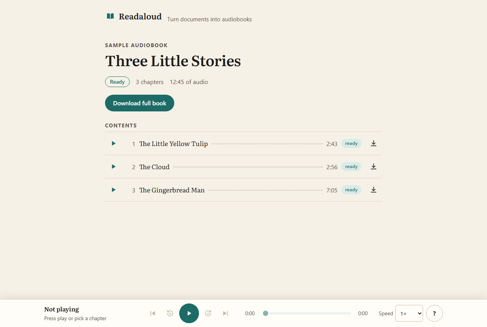
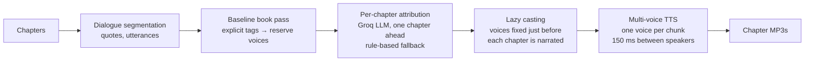
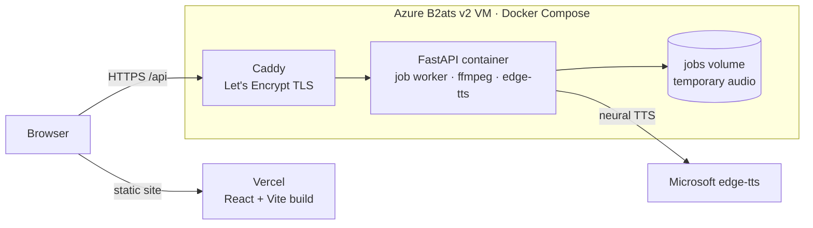

# Readaloud — AI-Powered Audiobook Generator

Readaloud turns a PDF or Word document into a chaptered audiobook. It recovers the document's
structure (chapters and sections) from layout, styles and text patterns, removes what should not be
read aloud (page numbers, running headers, captions, footnotes, tables, equations), narrates each
chapter with a neural voice, and lets you start listening to chapter 1 while the rest is still being
narrated. Play it in the browser at 0.5×–2× speed, or download single chapters or the whole book as
MP3. No account, no paid APIs.

**v2: character voices.** Optionally, novels can be read with one voice per character: dialogue is
detected, a free LLM works out who speaks each line, and each main character gets their own neural
voice while the narrator reads the rest.

UMC301 Applied Data Science and Artificial Intelligence — Project 2.

**Live:** <https://audiobook-generator-lekhya.vercel.app> · sample audiobook: <https://audiobook-generator-lekhya.vercel.app/sample> ·
character-voices sample: <https://audiobook-generator-lekhya.vercel.app/sample/characters> ·
backend health: <https://lekhya-audiobook.centralindia.cloudapp.azure.com/api/health>



## Features (v1)
- PDF (up to 200 pages) and DOCX (up to 100,000 words), up to 50 MB; clear messages for scanned,
  encrypted, corrupt, legacy `.doc` and other files.
- Clean narration: page numbers, running headers/footers, broken hyphenation, figure/table captions,
  footnotes, tables and equations are not read aloud. Two-column pages are read column by column.
- Chapter detection: built-in PDF outline → Word heading styles → typography → text patterns →
  fallback parts; contents pages and back matter (references, index) are dropped.
- Neural narration with edge-tts (4 chunks in parallel), with retries; a chapter that cannot be
  narrated completely is marked failed instead of silently skipping text.
- Chapters become playable one by one; the player auto-advances and waits for the next chapter if it
  isn't ready yet.
- Player: play/pause, ±15 s, seek, previous/next chapter, speed 0.5×–2× (pitch preserved), keyboard
  shortcuts, lock-screen controls; it remembers your chapter, position and speed.
- Downloads: any chapter or the full book as one MP3 with readable filenames.
- A pre-generated sample audiobook that works even when the backend is down.
- Temporary by design: audio is deleted within 24 hours; uploads are limited to 10 per IP per hour.

## Features (v2: character voices)
- An upload choice: **Single narrator** (default, exactly the v1 behaviour) or **Character voices
  (beta)**, offered only when the server has an LLM key.
- Dialogue detection: quotes are found per paragraph (curly or straight, single or double marks,
  apostrophes and damaged PDF quote marks handled), and broken quotes (`‘Well,’ said Alice, ‘I suppose
  so.’`) are kept as one utterance.
- Speaker attribution with an LLM (Groq, `qwen/qwen3.8-27b`) on windows of about 1,200 words, with a
  rule-based fallback (speech tags, pronouns, turn-taking) whenever the LLM fails or is out of budget.
- A cast: aliases merged (`Hatter` / `the Mad Hatter`), genders from the LLM, and up to 8 distinct
  edge-tts voices; minor characters share one voice per gender; unknown speakers keep the narrator.
- Multi-voice narration: a short pause between speakers, quote marks never read, titles always read
  by the narrator.
- In the book page: "Finding the characters… (window 3 of 12)", a **Cast** list with each voice, and a
  note on chapters whose speakers came from the rule-based fallback.
- A static character-voices sample: *Alice in Wonderland*, chapter 7 (`/sample/characters`).

## How it works


Each chapter is narrated and assembled before the next one starts, so chapter 1 can be played while
later chapters are still in progress. Audio is always streamed to files in the job folder, never held
in memory.

Character-voices mode adds these steps between structure detection and narration:



Chapter 1 is attributed first; while chapter N is narrated, chapter N+1 is attributed in the same
event loop. Voices are assigned lazily: the whole-book rule pass only *reserves* voices for
characters that are clearly named often, and every character gets its voice (with the LLM's gender)
just before the first chapter it speaks in, and keeps it (D41).



## Evaluation

Chapter detection is measured on hand-labelled documents (SPEC §13):

| Set | Documents | Chapter F1 | Rejects | Noise paragraphs |
|---|---|---|---|---|
| Development set (`testset/`, rules were developed on it) | 10 | **1.00** (60/60) | 3/3 | 0 |
| Held-out set, **first run** (`testset_heldout/`, reported number) | 9 | **0.99** (78 of 79, precision 0.99, recall 0.99) | 4/4 | 0 |
| Held-out set, later runs (after a fix, 2026-10-16 and 2026-10-18) | 9 | 1.00 (79/79) | 4/4 | 0 |

How the matching works: detected and labelled titles are normalized (lower-case, chapter labels and
section numbers stripped, punctuation removed) and compared with `rapidfuzz.fuzz.ratio`. Pairs scoring
at least 80 are matched one-to-one, best pair first, and precision, recall and F1 are micro-averaged
over all documents. A separate check counts leaked page numbers or headers ("noise paragraphs").

Why a held-out set (D25): the cleaning and structure rules were tuned while looking at the development
documents, so their score is optimistic. The held-out documents were made with different tools and
never opened during development; their **first** score (0.99) is the honest number. Later runs are kept
in [`testset_heldout/results_history.md`](testset_heldout/results_history.md) so it stays clear which
number is truly held out.

### Character voices: dialogue and speakers

Three public-domain chapters were hand-labelled with a small labelling tool (every quote span, its
speaker, and whether a speech tag names the speaker): two **development** chapters (*Alice* ch. 7,
"The Absence of Mr Glass") and one **held-out** chapter (*The Ball and the Cross* ch. 3), which was
never opened during development and was run exactly once (D25, D35). Results:
[`testset_dialogue/results.md`](testset_dialogue/results.md), held-out:
[`results_heldout.md`](testset_dialogue/results_heldout.md), all runs:
[`results_history.md`](testset_dialogue/results_history.md).

**Quote detection** (a predicted span matches a gold span when they overlap by ≥ 80%):

| Set | Gold quotes | Precision | Recall | F1 | Grouping |
|---|---|---|---|---|---|
| Dev (Alice ch. 7 + Mr Glass) | 269 | 0.99 | 1.00 | **0.99** | 0.90 |
| Held-out (*Ball and the Cross* ch. 3), first run | 76 | 0.99 | 0.99 | **0.99** | 0.95 |

**Speaker attribution**, on the dev chapters (187 utterances). *Voice accuracy* is what the listener
hears: the share of utterances read in the voice the system gave the right character (or the
narrator for unknown speakers).

| Candidate | Voice acc | Alice | Mr Glass | Attribution acc | Explicit / implicit | Tokens | Median latency |
|---|---|---|---|---|---|---|---|
| Rule-based baseline | 0.71 | 0.91 | 0.38 | 0.72 | 0.74 / 0.67 | 0 | – |
| **LLM, `qwen/qwen3.8-27b`** (chosen) | **0.99** | 1.00 | 0.99 | 0.99 | 1.00 / 0.98 | 16,633 | 0.93 s |
| LLM + baseline override, qwen | 0.87 | 0.99 | 0.67 | 0.88 | 0.86 / 0.91 | 16,633 | 0.93 s |
| LLM, `openai/gpt-oss-120b` | 0.96 | 1.00 | 0.90 | 0.97 | 0.96 / 0.98 | 18,867 | 2.25 s |
| LLM + baseline override, gpt-oss | 0.84 | 0.99 | 0.61 | 0.86 | 0.85 / 0.89 | 18,867 | 2.25 s |

**Held-out first run** (*The Ball and the Cross* ch. 3, reported result, D40 configuration): voice
accuracy **0.83**, attribution accuracy **0.83** (explicit 0.96, implicit 0.67), 8% predicted
unknown. The other candidates there: baseline 0.48, override·qwen 0.67, llm·gpt-oss 0.54,
override·gpt-oss 0.65 voice accuracy. Dev 0.99 vs held-out 0.83 is the usual gap between data the
system was tuned on and data it has never seen; the gap is almost all in *implicit* lines (no speech
tag naming the speaker).

**Why the selection rule was fixed in advance (D39).** Before any attribution result existed, the
rule was written down: highest dev voice accuracy wins; candidates within 2 points tie, and ties go to
fewer tokens, then lower latency, then the override method. Applying it mechanically meant the
results could not be bent toward a favourite model. It picked `llm` with qwen (D40), and the held-out
run (made after everything was frozen) picked the same.

**Thinking off.** Qwen3 models can "think" before answering. Real requests on the same Alice window
gave **652 completion tokens with thinking on, off, or unset**, and never any reasoning text: on Groq
this model does not think, so `reasoning_effort: "none"` is kept only to make the intent explicit.
gpt-oss cannot turn thinking off (`none` is rejected); at `low` it spent 519 of 895 completion tokens
reasoning, which is why it is slower and costs more.

## Performance

| | Render free (first host) | Azure B2ats v2 (current) |
|---|---|---|
| CPU / RAM | 0.15 CPU, 512 MB, sleeps after 15 min | 2 vCPU, 1 GiB, always on |
| Narration speed (edge-tts, 4 in parallel) | 172 chars/s | **599–720 chars/s** |
| *Alice in Wonderland* (12 chapters, 2 h 36 min of audio) | – | narrated in **3 min 16 s** |
| Largest allowed book (100,000 words ≈ 537,000 chars) | ≈ 52 min | **≈ 12–15 min** |
| Peak memory of the app process | ≈ 100 MB | **131 MB** |
| Assembly per chapter (ffmpeg concat) | – | 0.4–0.5 s (5–11 s before durations were read from MP3 frames) |

The local Piper voice was measured too: it needs about 700 MB of the VM's 837 MB together with the
app (and was killed at 512 MB on Render), so the server uses edge-tts only (D26). Details:
[`docs/spike_results.md`](docs/spike_results.md).

**Character voices are slower (D42).** The binding limit is Groq's free tier for the chosen model:
**1,000 completion tokens per minute** on this key, about one attribution window (≈ 1,200 words) per
minute. The client paces itself on both token budgets instead of bouncing off 429 errors.
Measured locally through the API on the whole of *Alice* (12 chapters, 27 windows, 2 h 54 min of
audio):

| | Character voices | Single narrator |
|---|---|---|
| Total time | **12 min 21 s** (attribution ≈ 11.5 min, overlapping narration) | ≈ 3 min (VM) |
| Chapter 1 playable after | **1 min 00 s** | ≈ 10 s |
| Rate-limit (429) waits | 4 (4–12 s each) | – |
| Windows that fell back to the rules | 0 of 27 | – |
| Peak memory of the app process | **115 MB** | 131 MB (VM) |

For the largest allowed book (100,000 words) expect roughly 30–60 minutes of attribution; listening
can start after chapter 1, but later chapters may wait for their speakers. On the production VM a
characters-mode job peaked at 195 MiB for the API container (23% of the VM's 837 MiB); details in
[`docs/spike_results.md`](docs/spike_results.md).

## Limits and non-goals
- Limits: `.pdf`/`.docx` only, 50 MB, 200 PDF pages, 100,000 words; one job at a time with up to 3
  waiting; 10 uploads per IP per hour; audio kept at most 24 h (a server restart also clears it).
- Not supported: accounts or saved libraries, OCR / scanned PDFs, `.doc`/`.txt`/`.epub`,
  languages other than English, reading tables/captions/footnotes/equations, paid APIs.
- Character voices: up to 8 distinct voices per book (others share one minor voice per gender); a
  character keeps the first voice it gets, even if it turns out more important later; speakers the
  text doesn't make clear are read by the narrator; 800 LLM requests per day, after which (or when
  Groq is down) the rule-based fallback is used and the book page says so.
- **Privacy:** in character-voices mode the document's text is sent to Groq to find the speakers
  (stated on the upload page, D36). Single-narrator mode sends text only to the TTS service.

## Tech stack and layout

| Part | Tech |
|---|---|
| Backend | Python 3.11, FastAPI, PyMuPDF, python-docx, rapidfuzz, edge-tts, Piper (local only), ffmpeg, httpx (Groq API, v2) |
| Frontend | React 19 + Vite, react-router-dom, plain CSS; Vitest + Testing Library |
| Hosting | Azure VM with Docker Compose + Caddy (backend), Vercel (frontend) |

```
Project2/
├── backend/            FastAPI app
│   ├── app/api/        HTTP endpoints, errors, upload rate limit
│   ├── app/pipeline/   validate → extract → clean → structure
│   ├── app/tts/        normalize → chunk → engines → narrator/assembly
│   ├── app/dialogue/   v2: segment → attribute (rules + LLM) → cast → voices
│   ├── app/jobs/       in-memory job registry, worker thread, cleanup
│   ├── scripts/        evaluate, evaluate_dialogue, label_dialogue, extract, narrate, smoke_api, make_sample
│   └── tests/
├── frontend/           React app (pages, components, hooks, sample audiobook in public/sample)
├── deploy/             docker-compose.yml, Caddyfile, bootstrap.sh, deploy.sh
├── docs/               SPEC, DECISIONS, spike results, viva notes, screenshots
├── testset/            development set labels and results (documents not committed)
├── testset_heldout/    held-out labels and results history
└── testset_dialogue/   v2 dialogue chapters, speaker labels and results
```

## Run locally (Windows, PowerShell)

Needs Python 3.11/3.12, Node 20+, and ffmpeg/ffprobe on PATH.

```powershell
# backend
cd backend
python -m venv .venv
.venv\Scripts\Activate.ps1
pip install -r requirements.txt
copy .env.example .env
python scripts\check_env.py
uvicorn app.main:app --reload --port 8000

# frontend (new terminal)
cd frontend
npm install
npm run dev          # http://localhost:5173, uses the local API
npm run dev:remote   # same UI against the Azure API
```

Tests: `cd backend; pytest -q` (369 tests) and `cd frontend; npm test` (42 tests). Evaluation:
`cd backend; python scripts\evaluate.py` (add `--testset ..\testset_heldout` for the held-out set);
dialogue and speakers: `python scripts\evaluate_dialogue.py --methods all --models qwen/qwen3.8-27b,openai/gpt-oss-120b`
(Groq answers are cached on disk, so re-scoring is free). Character voices need `GROQ_API_KEY` in
`backend\.env` (free key from Groq).

Deploy: backend on the VM with [`deploy/README.md`](deploy/README.md) (`bash deploy.sh`); frontend on
Vercel with root directory `frontend`, the Vite preset, and `VITE_API_URL` set to the backend URL
(`frontend/vercel.json` rewrites every path to `index.html` for deep links).

## Key decisions

Full list with reasons: [`docs/DECISIONS.md`](docs/DECISIONS.md).

| # | Decision | Why |
|---|---|---|
| D4/D5 | Only PDF and DOCX; scanned PDFs rejected (no OCR) | Reliable extraction; OCR is slow and error-prone |
| D6 | 200 pages / 100,000 words / 50 MB | Bounded generation time and disk on free hosting |
| D8 | Tables, captions, footnotes, equations are skipped | They don't make sense spoken |
| D13 | Chapters generated in order, playable as soon as ready | Long books take minutes; start listening at once |
| D16/D25 | Labelled test set with F1; a held-out set never inspected | A measurable, honest result |
| D18/D19 | Jobs are temporary and not restored after a restart; the UI never promises a time | No paid storage |
| D26 | Server narrates with edge-tts only, with patient retries | Piper does not fit in the VM's memory next to the app |
| D27 | A chunk that fails fails its whole chapter | A listener must never miss text without being told |
| D28 | Backend on an Azure VM behind Caddy, not Render free | ~4× faster narration, always on |
| D30 | 10 uploads per IP per hour | Public site on student credit |
| D31/D33 | Character voices are opt-in; unknown speakers keep the narrator voice | v1 stays the default; a wrong voice is worse than the narrator |
| D32/D34 | Groq free tier for attribution, with a rule-based fallback; the LLM never fails a job | Free, and robust when the free tier is busy |
| D35/D39/D40 | Labelled dev + held-out chapters; a model-selection rule fixed before any results → `llm` with qwen | An honest, measurable choice between two LLMs |
| D36 | The upload page says the text is sent to Groq | Privacy |
| D37/D41/D42 | Attribute one chapter ahead; cast voices lazily per chapter; pace completion tokens | Fit Groq's 1,000 output tokens/min without wasting voices |

## Future work
- Character voices: let a character move from the shared minor voice to its own voice when it turns
  out to be important later, and better implicit-speaker attribution (the held-out weak spot).
- OCR for scanned PDFs, more input formats (EPUB), and more languages.
- Persistent storage so jobs survive a restart, and more than one worker for more users.

## Documentation
- [Specification](docs/SPEC.md) · [Decisions](docs/DECISIONS.md) · [Spike and deployment results](docs/spike_results.md)
- [Viva notes](docs/VIVA.md) · [Demo video shot list](docs/DEMO_VIDEO.md) · [Deployment](deploy/README.md)
