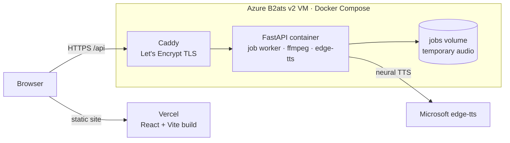

# Readaloud — AI-Powered Audiobook Generator

Readaloud turns a PDF or Word document into a chaptered audiobook. It recovers the document's
structure (chapters and sections) from layout, styles and text patterns, removes what should not be
read aloud (page numbers, running headers, captions, footnotes, tables, equations), narrates each
chapter with a neural voice, and lets you start listening to chapter 1 while the rest is still being
narrated. Play it in the browser at 0.5×–2× speed, or download single chapters or the whole book as
MP3. No account, no paid APIs.

UMC301 Applied Data Science and Artificial Intelligence — Project 2.

**Live:** <VERCEL_URL> · sample audiobook: <VERCEL_URL>/sample ·
backend health: <https://lekhya-audiobook.centralindia.cloudapp.azure.com/api/health>


## Features (v1)
- PDF (up to 200 pages) and DOCX (up to 100,000 words), up to 50 MB; clear messages for scanned,
  encrypted, corrupt, legacy `.doc` and other files.
- Clean narration: page numbers, running headers/footers, broken hyphenation, figure/table captions,
  footnotes, tables and equations are not read aloud. Two-column pages are read column by column.
- Chapter detection: built-in PDF outline → Word heading styles → typography → text patterns →
  fallback parts; contents pages and back matter (references, index) are dropped.
- Neural narration with edge-tts (4 chunks in parallel), with retries; a chapter that cannot be
  narrated completely is marked failed instead of silently skipping text.
- Chapters become playable one by one; the player auto-advances and waits for the next chapter if it
  isn't ready yet.
- Player: play/pause, ±15 s, seek, previous/next chapter, speed 0.5×–2× (pitch preserved), keyboard
  shortcuts, lock-screen controls; it remembers your chapter, position and speed.
- Downloads: any chapter or the full book as one MP3 with readable filenames.
- A pre-generated sample audiobook that works even when the backend is down.
- Temporary by design: audio is deleted within 24 hours; uploads are limited to 10 per IP per hour.

## How it works

```mermaid
flowchart LR
    U[Upload PDF / DOCX] --> V[Validate<br/>type, signature, size,<br/>pages, encryption, scanned]
    V --> X[Extract<br/>PyMuPDF / python-docx]
    X --> C[Clean<br/>headers, footers, hyphenation,<br/>captions, footnotes, equations]
    C --> S[Structure detection<br/>outline → styles → typography<br/>→ patterns → fallback]
    S --> N[Text normalization<br/>numbers, abbreviations, symbols]
    N --> K[Sentence chunking<br/>≤ 1,500 chars]
    K --> T[edge-tts neural voice<br/>4 chunks in parallel]
    T --> A[ffmpeg assembly<br/>concat without re-encoding]
    A --> M[Chapter MP3s]
    M --> P[Browser player<br/>stream with HTTP Range]
```



Each chapter is narrated and assembled before the next one starts, so chapter 1 can be played while
later chapters are still in progress. Audio is always streamed to files in the job folder, never held
in memory.



## Evaluation

Chapter detection is measured on hand-labelled documents (SPEC §13):

| Set | Documents | Chapter F1 | Rejects | Noise paragraphs |
|---|---|---|---|---|
| Development set (`testset/`, rules were developed on it) | 10 | **1.00** (60/60) | 3/3 | 0 |
| Held-out set, **first run** (`testset_heldout/`, reported number) | 9 | **0.99** (78 of 79, precision 0.99, recall 0.99) | 4/4 | 0 |
| Held-out set, later runs (after a fix, 2026-10-16 and 2026-10-18) | 9 | 1.00 (79/79) | 4/4 | 0 |

How the matching works: detected and labelled titles are normalized (lower-case, chapter labels and
section numbers stripped, punctuation removed) and compared with `rapidfuzz.fuzz.ratio`. Pairs scoring
at least 80 are matched one-to-one, best pair first, and precision, recall and F1 are micro-averaged
over all documents. A separate check counts leaked page numbers or headers ("noise paragraphs").

Why a held-out set (D25): the cleaning and structure rules were tuned while looking at the development
documents, so their score is optimistic. The held-out documents were made with different tools and
never opened during development; their **first** score (0.99) is the honest number. Later runs are kept
in [`testset_heldout/results_history.md`](testset_heldout/results_history.md) so it stays clear which
number is truly held out.

## Performance

| | Render free (first host) | Azure B2ats v2 (current) |
|---|---|---|
| CPU / RAM | 0.15 CPU, 512 MB, sleeps after 15 min | 2 vCPU, 1 GiB, always on |
| Narration speed (edge-tts, 4 in parallel) | 172 chars/s | **599–720 chars/s** |
| *Alice in Wonderland* (12 chapters, 2 h 36 min of audio) | – | narrated in **3 min 16 s** |
| Largest allowed book (100,000 words ≈ 537,000 chars) | ≈ 52 min | **≈ 12–15 min** |
| Peak memory of the app process | ≈ 100 MB | **131 MB** |
| Assembly per chapter (ffmpeg concat) | – | 0.4–0.5 s (5–11 s before durations were read from MP3 frames) |

The local Piper voice was measured too: it needs about 700 MB of the VM's 837 MB together with the
app (and was killed at 512 MB on Render), so the server uses edge-tts only (D26). Details:
[`docs/spike_results.md`](docs/spike_results.md).

## Limits and non-goals
- Limits: `.pdf`/`.docx` only, 50 MB, 200 PDF pages, 100,000 words; one job at a time with up to 3
  waiting; 10 uploads per IP per hour; audio kept at most 24 h (a server restart also clears it).
- Not supported in v1: accounts or saved libraries, OCR / scanned PDFs, `.doc`/`.txt`/`.epub`,
  languages other than English, reading tables/captions/footnotes/equations, multiple voices, paid APIs.

## Tech stack and layout

| Part | Tech |
|---|---|
| Backend | Python 3.11, FastAPI, PyMuPDF, python-docx, rapidfuzz, edge-tts, Piper (local only), ffmpeg |
| Frontend | React 19 + Vite, react-router-dom, plain CSS; Vitest + Testing Library |
| Hosting | Azure VM with Docker Compose + Caddy (backend), Vercel (frontend) |

```
Project2/
├── backend/            FastAPI app
│   ├── app/api/        HTTP endpoints, errors, upload rate limit
│   ├── app/pipeline/   validate → extract → clean → structure
│   ├── app/tts/        normalize → chunk → engines → narrator/assembly
│   ├── app/jobs/       in-memory job registry, worker thread, cleanup
│   ├── scripts/        evaluate, extract, narrate, smoke_api, make_sample
│   └── tests/
├── frontend/           React app (pages, components, hooks, sample audiobook in public/sample)
├── deploy/             docker-compose.yml, Caddyfile, bootstrap.sh, deploy.sh
├── docs/               SPEC, DECISIONS, spike results, viva notes, screenshots
├── testset/            development set labels and results (documents not committed)
└── testset_heldout/    held-out labels and results history
```

## Run locally (Windows, PowerShell)

Needs Python 3.11/3.12, Node 20+, and ffmpeg/ffprobe on PATH.

```powershell
# backend
cd backend
python -m venv .venv
.venv\Scripts\Activate.ps1
pip install -r requirements.txt
copy .env.example .env
python scripts\check_env.py
uvicorn app.main:app --reload --port 8000

# frontend (new terminal)
cd frontend
npm install
npm run dev          # http://localhost:5173, uses the local API
npm run dev:remote   # same UI against the Azure API
```

Tests: `cd backend; pytest -q` (238 tests) and `cd frontend; npm test` (33 tests). Evaluation:
`cd backend; python scripts\evaluate.py` (add `--testset ..\testset_heldout` for the held-out set).

Deploy: backend on the VM with [`deploy/README.md`](deploy/README.md) (`bash deploy.sh`); frontend on
Vercel with root directory `frontend`, the Vite preset, and `VITE_API_URL` set to the backend URL
(`frontend/vercel.json` rewrites every path to `index.html` for deep links).

## Key decisions

Full list with reasons: [`docs/DECISIONS.md`](docs/DECISIONS.md).

| # | Decision | Why |
|---|---|---|
| D4/D5 | Only PDF and DOCX; scanned PDFs rejected (no OCR) | Reliable extraction; OCR is slow and error-prone |
| D6 | 200 pages / 100,000 words / 50 MB | Bounded generation time and disk on free hosting |
| D8 | Tables, captions, footnotes, equations are skipped | They don't make sense spoken |
| D13 | Chapters generated in order, playable as soon as ready | Long books take minutes; start listening at once |
| D16/D25 | Labelled test set with F1; a held-out set never inspected | A measurable, honest result |
| D18/D19 | Jobs are temporary and not restored after a restart; the UI never promises a time | No paid storage |
| D26 | Server narrates with edge-tts only, with patient retries | Piper does not fit in the VM's memory next to the app |
| D27 | A chunk that fails fails its whole chapter | A listener must never miss text without being told |
| D28 | Backend on an Azure VM behind Caddy, not Render free | ~4× faster narration, always on |
| D30 | 10 uploads per IP per hour | Public site on student credit |

## Future work
- **v2: one voice per character** — detect dialogue, attribute each line to a speaker with a free LLM
  (Gemini or Groq), merge character aliases, map characters to distinct edge-tts voices, a v1/v2
  narration toggle and cast list in the UI, and measure speaker-attribution accuracy on a labelled
  chapter (SPEC §15).
- OCR for scanned PDFs, more input formats (EPUB), and more languages.
- Persistent storage so jobs survive a restart, and more than one worker for more users.

## Documentation
- [Specification](docs/SPEC.md) · [Decisions](docs/DECISIONS.md) · [Spike and deployment results](docs/spike_results.md)
- [Viva notes](docs/VIVA.md) · [Demo video shot list](docs/DEMO_VIDEO.md) · [Deployment](deploy/README.md)
